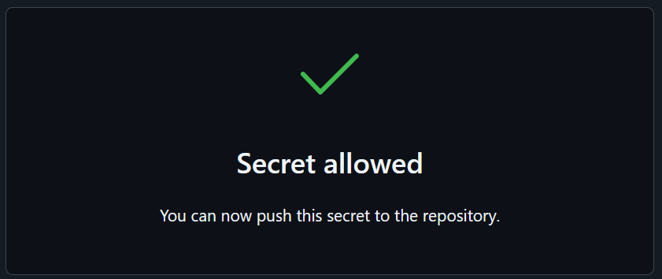
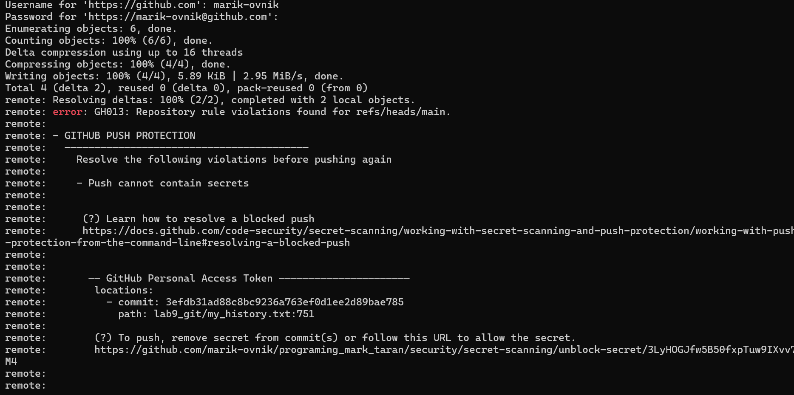

# ОТЧЁТ

## 1. Проверка статуса и добавление файла

Пишем команду `git status`.

Добавляем файл.

Смотрим ветки.

Вывод не меняется, если отсутствуют завершённые изменения.

Ничего не изменилось, так как новых коммитов в этой ветке не было.

## 2. Создание второго файла

Создаём второй файл.

Проверяем — нет, не появился.

## 3. Задание 4

Список пустой.

Добавляем изменения в `staged`, и всё меняется наоборот.

Изначально у нас был список изменений, которые должны быть закоммичены, а второй список был пустым.

Затем мы всё закоммитили, и теперь первый список пустой, а второй — полный.

Сделали `git restore`, и теперь:

Вывели содержимое файла.

После `restore`:

Содержимое осталось таким, каким было до последних изменений, так как мы ранее сделали `git add`.

## 4. Работа с ветками и слияние

Переключаемся на другую ветку.

Сравниваем ветки.

Выполняем слияние веток (`merge`).

Ещё раз выполняем `merge`, так как в первый раз слияние не получилось.

Перемержили.

Быть кодером — мержить вечно.

## 5. Просмотр истории коммитов

Выводим лог.

Также можно посмотреть обрезанную историю чата, где я разбирался с ошибками.

# THE END

вы можете посмотреть обрезанную историю чата как я тупил

#THE END

