#OTCHET
пишем статус
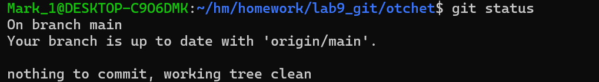
добавляем файл

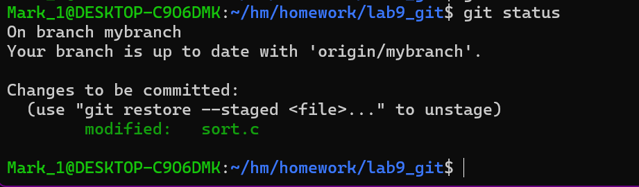
 смотрим ветки 

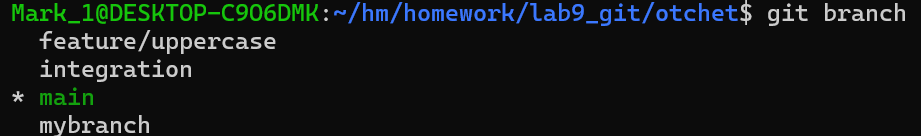
вывод не меняется если отсутствуют законченные изменения
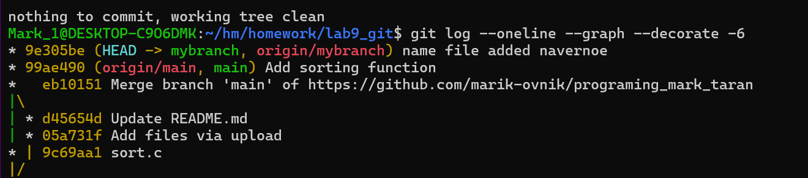
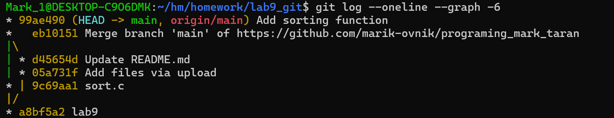
ничего так ка новых коммитов на ней не было
создаем файл2
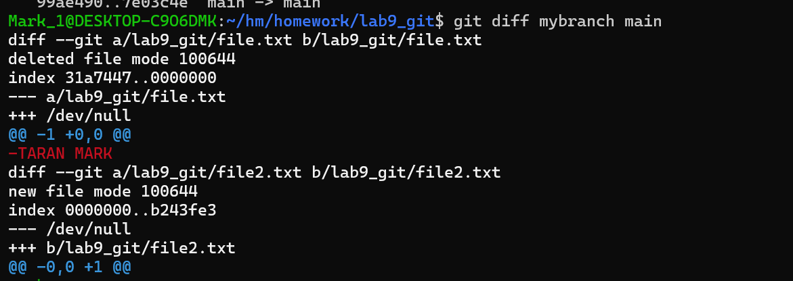
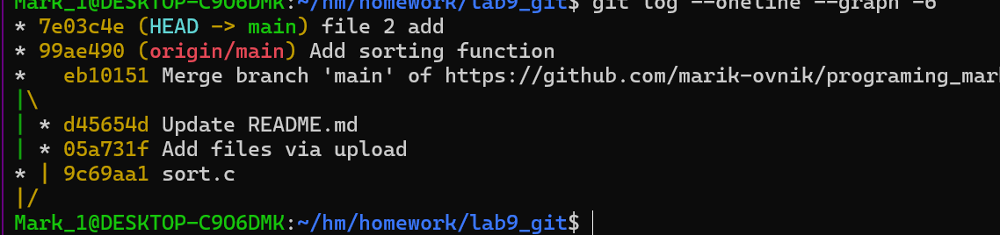
-нет не появился
#на 4
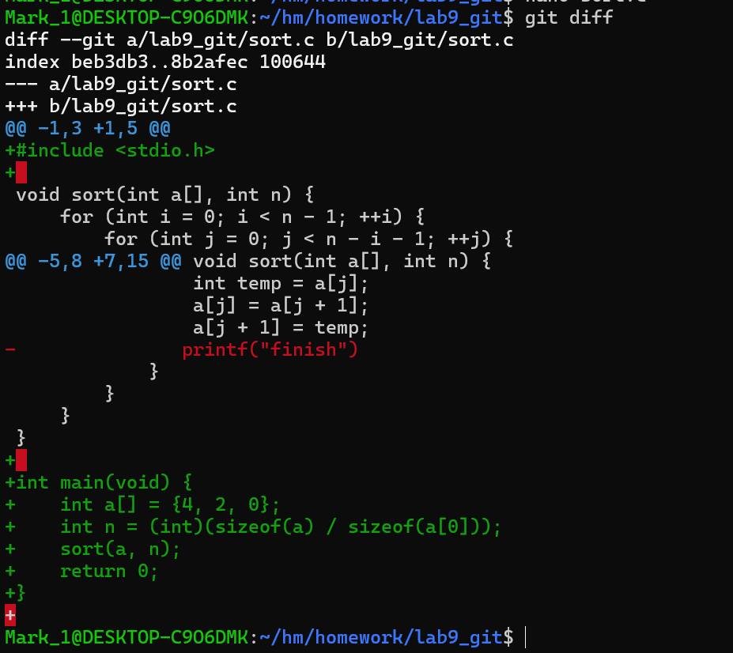
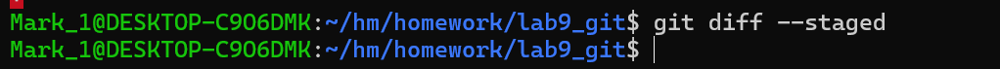
пустой
добавим в staged и все меняется 
наоборот
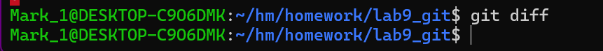
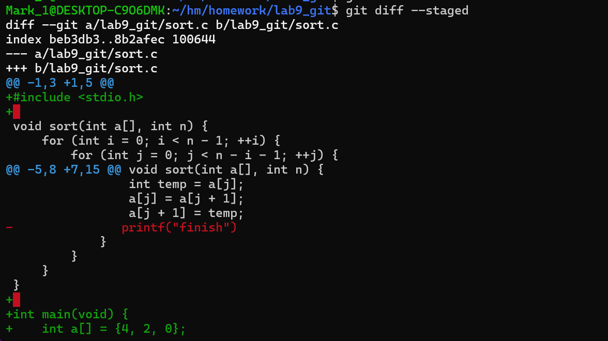
у нас сначала был список для что должно быть закомичино и не было ничего что уже запушенно, но не запушенно
затем мы все закомитили и теперь первое пустое, а второе полное
cделали рестор и теперь
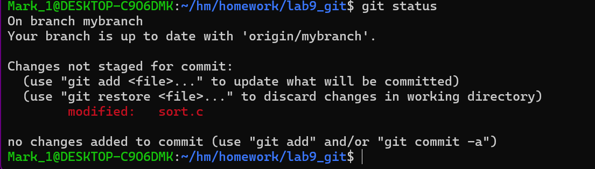
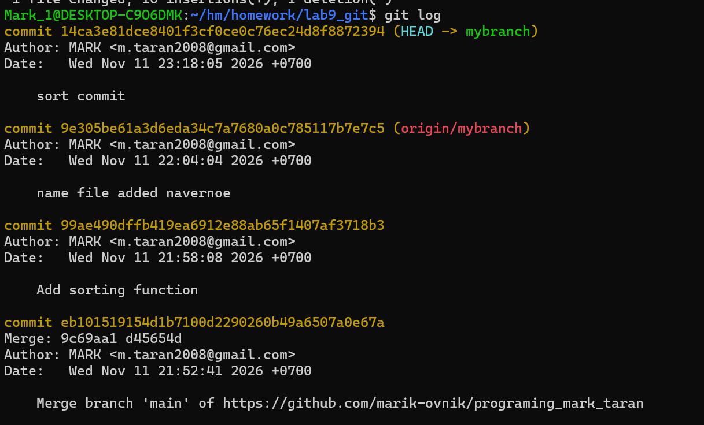
вывели
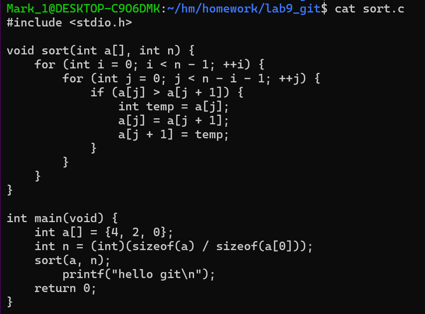
после рестор
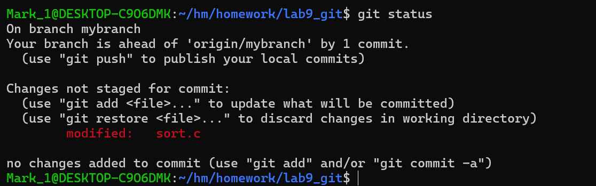
содержимое как до изменений так как мы сделали add
переключаемся на другую ветку 
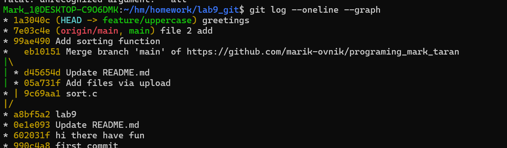
сравниваем ветки
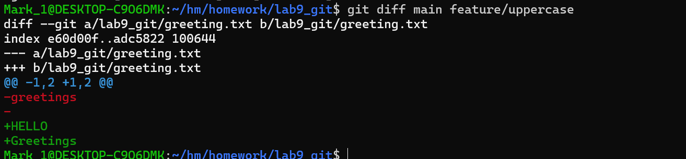
мержим
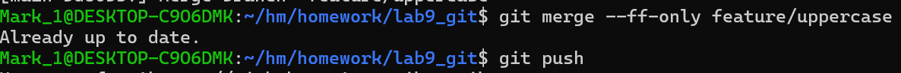
ещё раз мержим так как в первфй раз не намержились
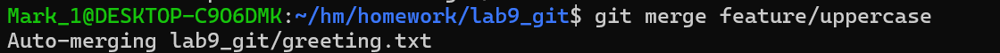
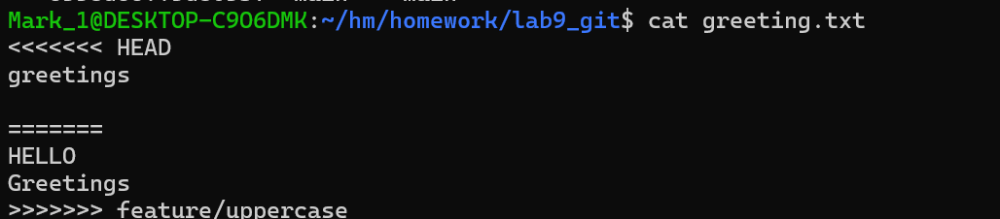
перемержили
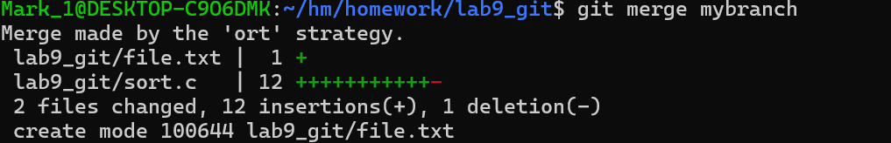
быть кодером мержить вечно
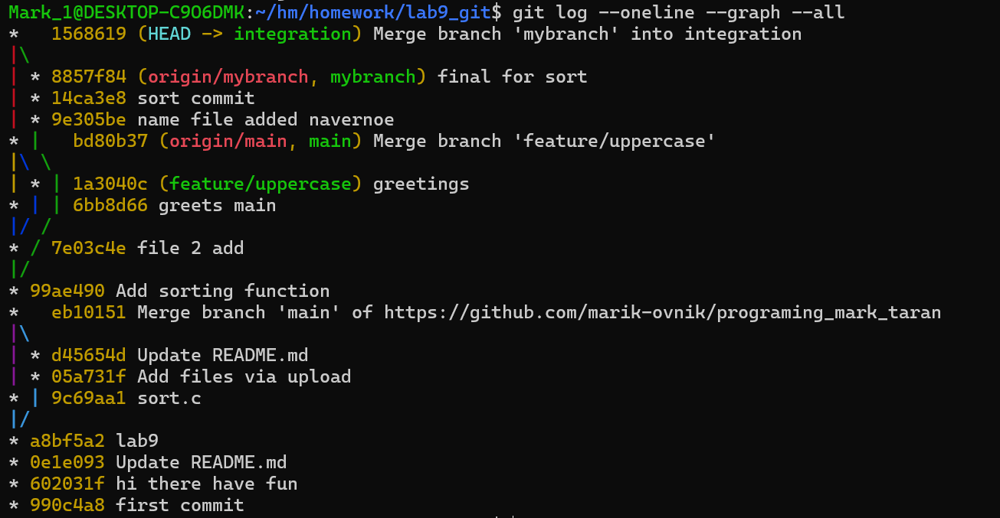
вывод лога

вы можете посмотреть обрезанную историю чата как я тупил

#THE END

